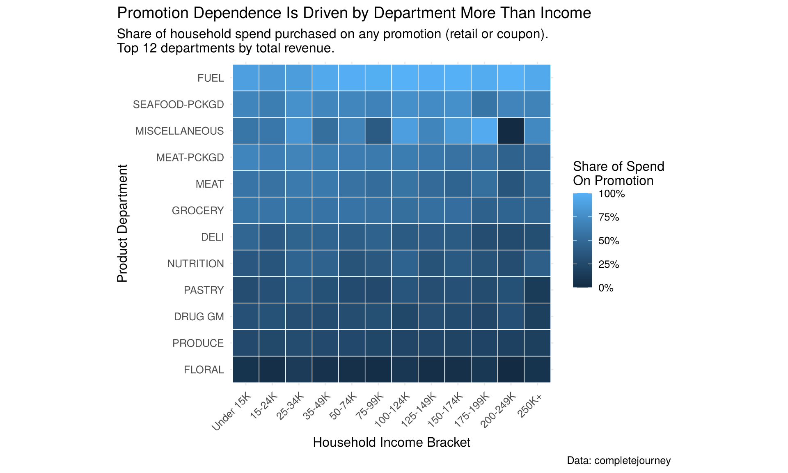
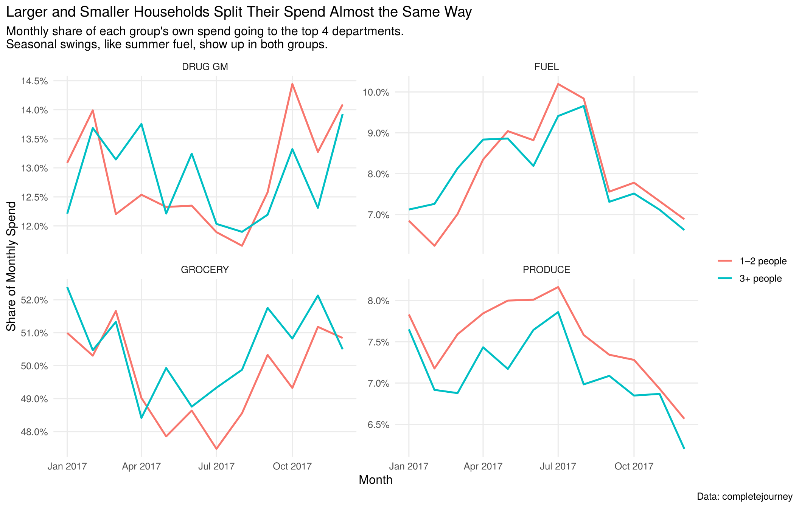
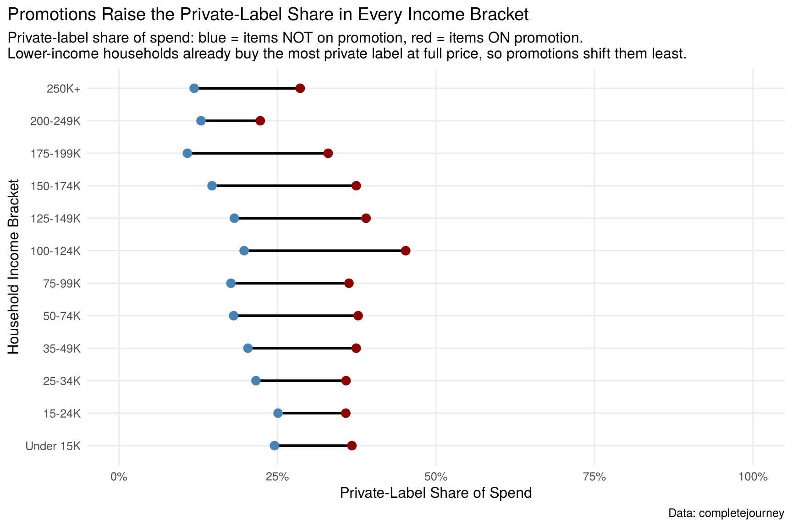

# Complete Journey: Three Visual Stories

Three charts on grocery shopping behaviour, built in R with the tidyverse and ggplot2. They use **The Complete Journey**, a public dataset from 84.51° with a year of grocery transactions (1.47 million line items from 2,469 households). The charts compare income and household size, so they use the 801 households that have demographic data: about 829,000 transactions.

The questions:

1. How much does spending on promotion depend on income, and how much on department?
2. Do larger households split their basket differently from smaller ones across the year?
3. Do promotions push shoppers toward private-label (store-brand) products?

**Timeline:** original Week 5 lab completed in Summer 2026. Charts corrected and published here in November 2026 (see [Data notes](#data-notes)).

## 1. Promotion dependence is driven by department, not income



Fuel is almost always bought on a discount. Floral, produce and drug/general merchandise are mostly bought at full price. Within a department, the share barely changes from one income bracket to the next. The few outliers, such as Miscellaneous at $200–249K, come from brackets with very few households (5–11 in the top three).

## 2. Larger and smaller households split their spend almost the same way



Grocery takes about half of each group's spend: 49.7% for 1–2-person households and 50.5% for 3+ person households. Drug/GM, produce and fuel are similarly close. The seasonal pattern is shared too: fuel's share rises through the summer and falls in the autumn for both groups. Household size does not change how the basket is split, although larger households spend about 20% more each over the year.

## 3. Promotions raise the private-label share in every income bracket



Items on promotion are about twice as likely to be store brand (37% of promoted spend vs 19% of full-price spend). Lower-income households already buy the most private label at full price, around 25% under $25K, so promotions shift them the least. The biggest jumps are in the middle and upper-middle brackets.

## Data notes

Two details of the dataset are easy to get wrong:

- **Discounts are stored as positive amounts.** `retail_disc`, `coupon_disc` and `coupon_match_disc` are 0 or above, so a purchase counts as "on promotion" when their sum is **> 0**. A `< 0` test silently marks nothing as on promotion.
- **`household_size` counts people, not children.** It is used here as "1–2 people" vs "3+ people". The dataset has a separate `kids_count` column for children.

Chart 2 divides each group's spend in a department by **that group's own** monthly spend. Dividing by everyone's spend would mostly show that there are more small households (573) than large ones (228).

## Run it

In R (4.x):

```r
install.packages(c("tidyverse", "completejourney", "rmarkdown"))
rmarkdown::render("visual_stories.Rmd")
```

`get_transactions()` downloads the full transactions table (about 13 MB) the first time it runs. The rendered output, with code and charts, is in [`visual_stories.html`](visual_stories.html). Download it and open it in a browser.

## Files

```
visual_stories.Rmd    analysis and charts (R Markdown)
visual_stories.html   rendered notebook
docs/plot1-3.png      the three charts
```

## Data

The Complete Journey is © 84.51°, distributed in the [`completejourney`](https://github.com/bradleyboehmke/completejourney) R package.
